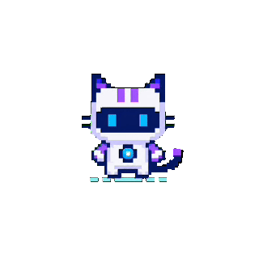

<h1 align="center">Desk Pet AI</h1>

<p align="center">
  一只住在桌面上的本地优先 AI 桌宠：有记忆、有情绪，会自己决定要不要动。
</p>

<p align="center">
  
  
  
  
</p>

> [!WARNING]
> 早期开发中：功能和接口都会变，安装包与文档可能落后于代码。请自行承担风险。

Desk Pet AI 不是给桌面换一张皮肤，而是在尝试让模型拥有一套**能长期存在的身体与潜意识**：

- **模型**负责说话、做决定；
- **Python 网关**负责记忆、情绪、直觉、工具和「潜意识」；
- **两个壳**（Electron / Tauri）负责把它画在桌面上，让它能走、能推、能看。

<p align="center">
  
  <br>
  <sub>内置主题 cybercat · 另有 calico / cloudling / hamster / zero</sub>
</p>

## 它特别在哪

| 能力 | 说明 |
|---|---|
| **记忆即自我** | 事件有权重、会衰减、会被概率性想起、会在梦里被压缩；模型还能自己维护一个「记忆」文件夹，分类结构由它决定。 |
| **情绪不是表情包** | 身体情绪（自评 → 情绪指数 → 温度/闪现频率）与语言情绪（允许情绪进入措辞本身）分开处理。 |
| **潜意识是插件内核** | 衰减、回忆、共鸣、体感、说话冲动、梦境都是可热插拔的「器官」；模型能用 `pet_forge_plugin` 给自己长新器官。 |
| **心声是一个按钮** | 直觉默认低概率冒头，元直觉只调「要不要更活跃」，整合层给出一条**可按可不按**的念头；动作和措辞始终由模型自己决定。 |
| **桌面是物理世界** | 任务栏、窗口、桌面图标都可以是刚体；猫会掉落、被顶起、站在图标上，也能推/拉/踢/拎起窗口（Windows 优先）。 |
| **只看见看得见的** | 朝向前方 ±30°、400px 内的刚体才进入「视野」；视野外的它不知道。 |
| **自进化** | 器官、技能、直觉都能由模型自己写、热加载、失败回滚——「一切皆插件」的工程化版本。 |
| **本地优先** | 优先跑本地 GGUF（llama.cpp + LoRA）；没有本地模型时也可以接 OpenAI 兼容 API。 |

> 这些是**实验性**能力：情绪/记忆会刻意模拟人格，模型输出可能显得过于拟人，请当作 AI 生成内容甄别。它没有意识（至少不是碳基的）。

## 架构

三个进程，一套本地契约：

```text
┌──────────────── 壳（身体）────────────────┐
│ Electron 0.10（主力）   Tauri 0.1（原型）  │
│ 窗口 / 输入 / 动画 / 设置 / 桌面物理        │
└──────────────────┬───────────────────────┘
                   │ HTTP + SSE  127.0.0.1:18765
┌──────────────────▼───────────────────────┐
│ Python 网关（FastAPI，无 torch）           │
│ 对话编排 / provider / 记忆 / 情绪 / 直觉    │
│ 器官插件 / skills / MCP / 屏幕 / 自更新     │
└──────────────────┬───────────────────────┘
                   │ OpenAI 兼容  127.0.0.1:18766
┌──────────────────▼───────────────────────┐
│ llama-server（GGUF + LoRA）或云端 API      │
└──────────────────────────────────────────┘

旁路：coding-agent hooks → :23333 → 状态机 → 动画（默认关闭）
```

- 有本地模型时，网关会自己拉起 `llama-server`；父进程退出，看门狗会在约 2 秒内收掉子进程。
- 壳只负责显示和输入；聊天流由渲染进程直连网关，不经过主进程转发。
- 记忆按动画主题隔离：换主题 = 换身体，但 `body-changes.json` 维持「我还是我」的连续线。

## 两个壳

| 版本 | 路径 | 体积 | 状态 |
|---|---|---|---|
| **Electron（原版）** | [`clawd-on-desk/`](./clawd-on-desk) | 安装包约 770 MB | 功能完整，当前主力 |
| **Tauri（重写）** | [`deskpt-tauri/`](./deskpt-tauri) | 壳约 10.7 MB（不含大脑/模型） | 原型：聊天、菜单、设置、虚拟桌面已有实现；动画、物理、工具链补齐中 |

Git 标签：`v0.10.0-electron` 标记原 Electron 壳；`v0.1.0-tauri` 标记首个 Tauri 重写版。

## 快速开始

### Windows

```powershell
git clone https://github.com/aorucshiea/desk-pet-ai.git
cd desk-pet-ai
.\deskpt-dev.ps1
```

首次运行会自动创建 `pet-sidecar/.venv`、安装依赖、启动 Electron。需要 Node.js 18+；网关源码需要 Python 3.10–3.12（脚本会检查）。

### macOS / Linux

```bash
git clone https://github.com/aorucshiea/desk-pet-ai.git
cd desk-pet-ai
./go.sh doctor   # 检查 Node / uv / 环境
./go.sh          # 安装依赖并启动
```

### 没有本地模型？

也可以直接用：

1. 启动后打开 **设置 → 模型来源**，配置 LM Studio / Ollama / OpenAI 兼容 API；
2. 或把 `.gguf` 放进 `models/`，在 **设置 → 模型** 里选择；
3. 本地模型是可选项，不是启动前提。

> **本地小模型第一次回复慢，不是卡死。** 网关要把人设 + 记忆 + 上下文整段做预填充（prefill），
> 这段耗时取决于模型和显存/CPU 的预填充速度，**和 LM Studio 里把 context 调大基本无关**。
> 网关对 loopback 端点（LM Studio / Ollama / llama.cpp）默认关闭工具调用、把输出预算降到 768，
> 并给到 300 秒超时；要恢复工具调用，在 `~/.pet/providers.json` 对应 provider 上加
> `"toolsEnabled": true`。日志里的 `prompt budget` / `first token after` 两行可以直接看出慢在哪。

端口：网关 `18765`、llama-server `18766`、coding-agent hook 服务 `23333–23337`。

### 打包

```bash
# Windows（需要先生成 pet-sidecar/bin/win-x64 下的 sidecar 二进制）
cd clawd-on-desk && npm run build:win:x64

# macOS arm64 dmg
./go.sh build
```

打包脚本会校验 sidecar 二进制和 LoRA 适配器；缺少时请先跑 `pet-sidecar/scripts/build-all.sh` 或 `npm run fetch:sidecars` / `fetch:adapters`。

## 仓库结构

```text
desk-pet-ai/
├── clawd-on-desk/      Electron 壳 + 聊天/设置/物理/主题
├── deskpt-tauri/       Tauri 重写壳（Rust + 原版 UI）
├── pet-sidecar/        Python 网关 + llama.cpp 子进程管理
├── adapters/           LoRA 人格适配器（权重不入库）
├── anim-engine/        视频 → 透明 GIF 的动画生成管线（实验）
├── skills/             工程向 Agent Skills（部署 / LoRA / OpenVINO）
├── docs/               开发、自主性架构、Backlog
├── 前瞻/               尚未拍板的方向性设计（骨架/物理/情绪/动画）
├── models/             本地 GGUF（gitignored，不放仓库）
└── go.sh / deskpt-dev.ps1
```

## 现在到哪了

**已跑通**

- 本地/云端对话、流式输出、工具循环、loRA 人格
- 事件记忆、衰减、概率回忆、共鸣、梦境、核心记忆、「记忆」文件夹
- 身体情绪 + 语言情绪提示词、情绪指数调制温度/闪现
- 瞬时记忆、直觉注册表、元直觉、骰子、整合层、心声、身体日志
- 桌面物理：任务栏跟随、窗口/桌面图标刚体、AI 推拉踢拎、视锥
- 器官插件热加载、模型自创器官、自创直觉、skills / MCP
- 屏幕观察、OmniParser、Holo GUI agent（默认关闭、需授权）

**接下来**

- 睡眠压缩自动触发 + 睡眠模型配置（目前需手动 `/api/compress`）
- Tauri 壳与 Electron 的功能对齐
- 动画统一后端：GIF / Live2D / 3D 三层 + 官方新主题
- Laya 小脑（姿态决策）、TTS / ASR、3D 桌面世界
- 更小的安装包（目标 ~100 MB 级）

**已知限制**

- Windows-first；macOS/Linux 的部分路径未做真机 QA
- Tauri 仍是原型，部分设置项是安全占位
- 模型权重不随包分发，首次使用需要下载或自备
- 情绪/记忆/决策都是实验性设计，行为和接口都可能变

## 文档

| 文档 | 内容 |
|---|---|
| [`clawd-on-desk/AGENTS.md`](./clawd-on-desk/AGENTS.md) | 代码入口、模块职责、约束与高风险坑 |
| [`docs/development.md`](./docs/development.md) | 开发/打包/调试 |
| [`docs/autonomy-architecture.md`](./docs/autonomy-architecture.md) | 「意识 + 潜意识」的自主性架构 |
| [`docs/BACKLOG-bugs.md`](./docs/BACKLOG-bugs.md) | 已诊断 bug 与待办 |
| [`前瞻/`](./前瞻/) | 尚未拍板的骨架/物理/情绪/动画设计 |
| [`pet-sidecar/README.md`](./pet-sidecar/README.md) | 网关、模型、LoRA、SSE 协议 |
| [`deskpt-tauri/README.md`](./deskpt-tauri/README.md) | Tauri 壳的复刻策略与现状 |
| [`CONTRIBUTING.md`](./CONTRIBUTING.md) | 贡献流程、提交规范、测试 |

## 开发与测试

```bash
# Electron 壳（Node 内置 test runner）
cd clawd-on-desk && npm test

# Python 网关
cd pet-sidecar && uv run pytest -q
```

> 跑 Python 测试时请使用临时记忆目录（例如 `PET_MEMORY_DIR=$TMP/pet-test`），避免测试写入真实记忆。

## 许可证与致谢

- 本项目与 `clawd-on-desk/` 均以 **[AGPL-3.0-only](./LICENSE)** 发布。
- Electron 壳 fork 自 [`rullerzhou-afk/clawd-on-desk`](https://github.com/rullerzhou-afk/clawd-on-desk)（上游 commit `5b1f003`）。
- 推理基于 [`llama.cpp`](https://github.com/ggml-org/llama.cpp)；模型权重来自 OpenBMB / DeskPet 系列，权重许可以其发布页为准。
- LoRA 适配器使用 NekoQA-30K 数据集训练；第三方资产与许可见 [`NOTICE.md`](./NOTICE.md)。

---

## English overview

**Desk Pet AI** is a local-first desktop pet with a persistent self. A local model (GGUF via llama.cpp, optional LoRA) does the talking; a Python gateway owns memory, emotion, intuition, tools and the "subconscious"; two shells (Electron / Tauri) draw it on your desktop.

- **Memory as self** — weighted events, decay, probabilistic recall, resonance, dreaming, and a model-owned `记忆/` folder.
- **Emotion** — a body-emotion index plus a language-emotion layer, both feeding generation.
- **Subconscious** — hot-swappable organ plugins; intuitions, meta-intuition, dice and a body log produce an *optional* inner voice, never a command.
- **Desktop physics** — taskbar / windows / desktop icons as rigid bodies; the pet can fall, be lifted, and push/pull/kick/grab windows (Windows-first).
- **Vision cone** — only bodies within ±30° and 400 px are "visible".
- **Self-evolution** — the model can write new organs and intuitions, hot-reload them, and roll back on failure.
- **Local-first** — can run fully locally on a GGUF; falls back to an OpenAI-compatible provider when no local model is available.

Quick start: Windows `.\deskpt-dev.ps1`; macOS/Linux `./go.sh`. See the Chinese sections above for details.

License: [AGPL-3.0-only](./LICENSE). Forked from `rullerzhou-afk/clawd-on-desk`; inference powered by `llama.cpp`.

---

如果觉得这个项目有点意思，欢迎 star、提 issue 或 PR。
